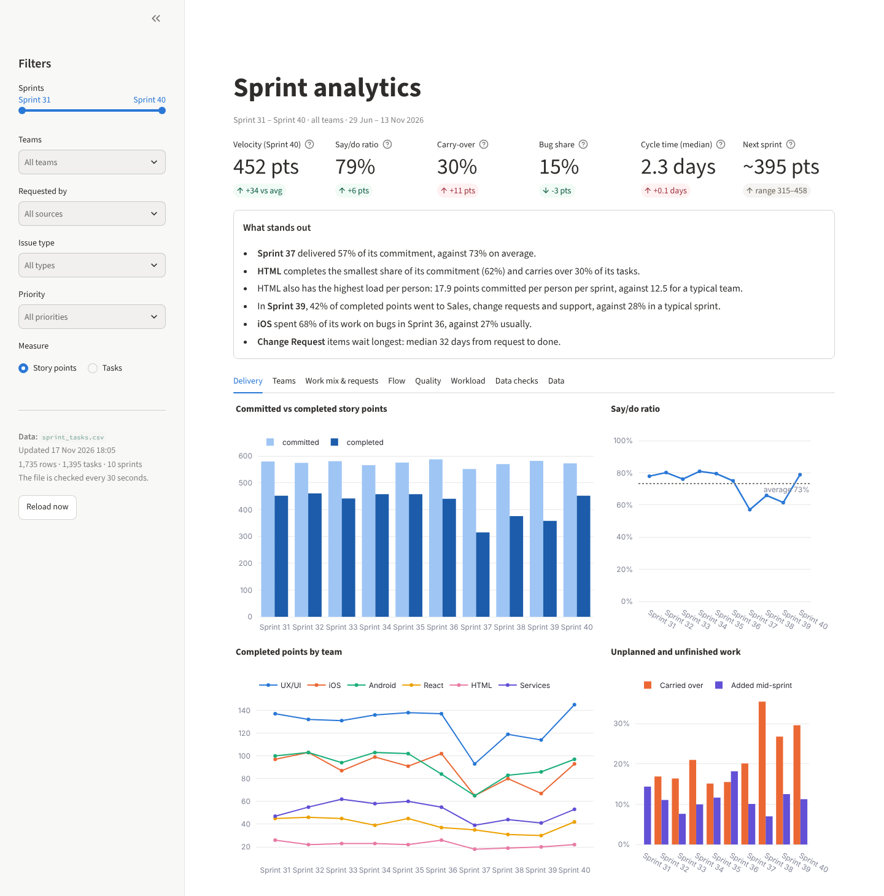
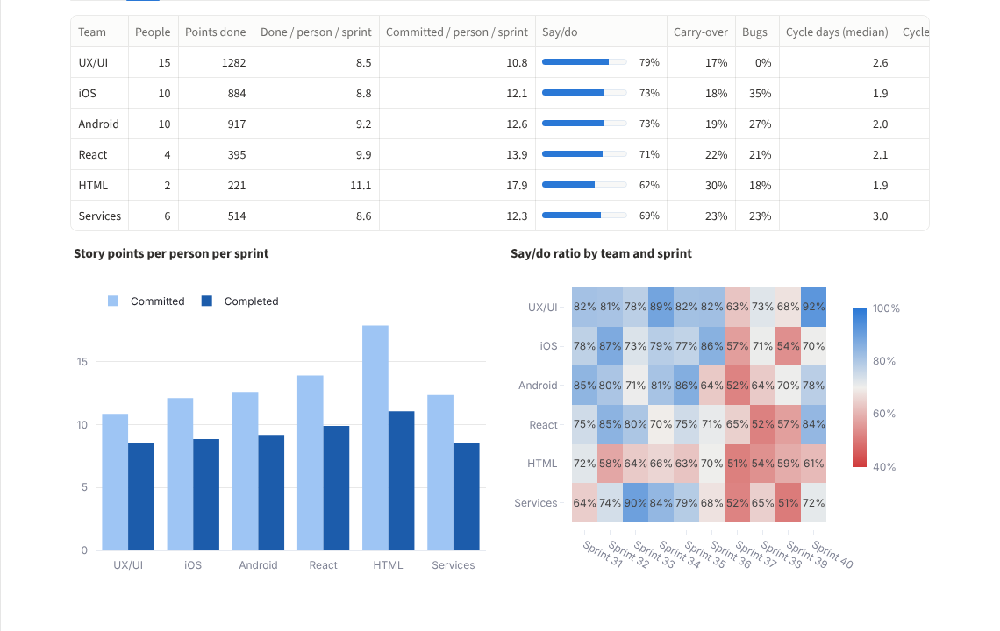
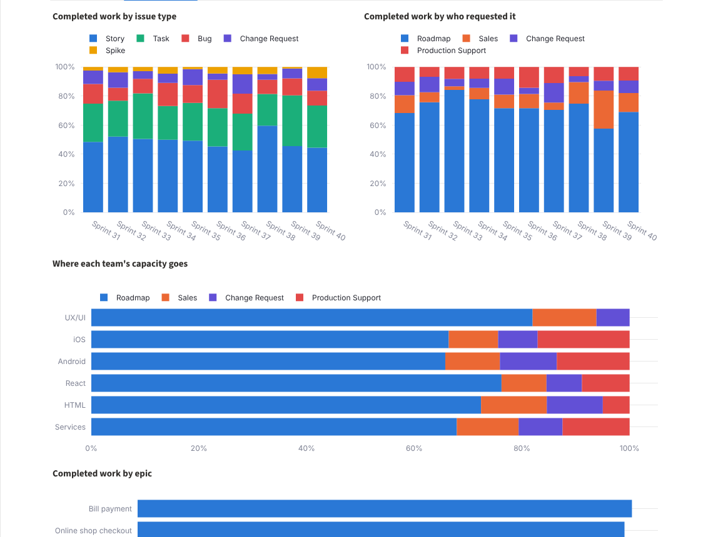
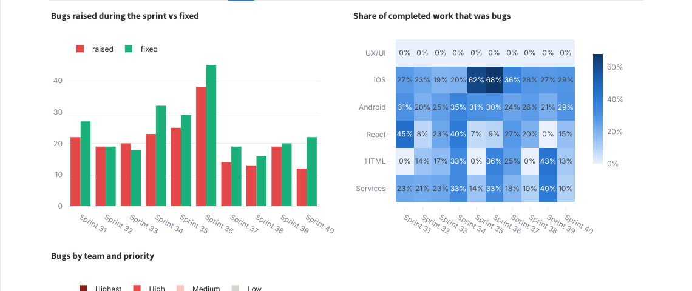

# Jira Sprint Analytics

A Streamlit dashboard for a multi-team digital delivery organisation, built from one CSV of Jira tasks. It answers the questions sprint reviews and steering meetings keep asking:
- **Are we delivering what we commit to?**
- **Which team is overloaded?**
- **How much capacity goes to sales requests, change requests and production support instead of the roadmap?**
- **Where does work wait?**

Replace the CSV with a new export and the dashboard picks it up within 30 seconds, with no code changes and no restart.



The repository runs on **mock data** for a fictional digital team of 47 people over 10 two-week sprints:

| Team | People |
|---|---|
| UX/UI | 15 |
| iOS | 10 |
| Android | 10 |
| Services (back end) | 6 |
| React | 4 |
| HTML | 2 |

Work comes from four sources: **Roadmap, Sales, Change Requests and Production Support**.

## What the dashboard shows

| Section | Answers |
|---|---|
| **Headline** | Velocity, say/do ratio, carry-over, bug share and cycle time for the latest sprint against the earlier ones; a next-sprint forecast with its recent range |
| **What stands out** | Findings written automatically for the current filters, for example *"HTML completes the smallest share of its commitment (62%) and carries over 30% of its tasks"* |
| **Delivery** | Committed vs completed points, say/do trend, velocity by team, carried-over and mid-sprint work |
| **Teams** | People, points per person (committed and completed), say/do, carry-over, bug share, cycle time; say/do heatmap by team × sprint |
| **Work mix & requests** | Completed work by issue type and by who requested it, where each team's capacity goes, work by epic |
| **Flow** | Cycle time (started → done) by team, lead time (requested → done) by issue type, the longest waits |
| **Quality** | Bugs raised vs fixed, bug share heatmap by team × sprint, bugs by priority |
| **Workload** | Committed vs completed points per person within a team, for balancing work, not for ranking people |
| **Data checks** | Problems in the Jira data itself: done without points or dates, no team, duplicates, no request source |
| **Data** | The filtered rows, downloadable |

Filters for sprint range, team, requested by, issue type, priority, and story points vs task counts apply to everything.




## What the mock data hides (and the dashboard finds)

| Story | Where it shows |
|---|---|
| Public holiday in **Sprint 37**: less capacity, same plan | Say/do drops to 57%; velocity dips for every team |
| **Sales campaign in Sprints 38–39** | Sales share of completed work triples; roadmap share falls; carry-over climbs to 35% |
| **HTML team (2 people) overloaded** | Highest committed load per person (≈18 vs ≈12 points), lowest say/do, most carry-over |
| **iOS release with bugs** in Sprints 35–36 | iOS spends 68% of its work on bugs in Sprint 36, against 27% usually |
| **Change requests wait longest** | Median lead time ≈32 days, against ≈17 for stories |



## The CSV

One row per task per sprint. A task that rolls over appears again in the next sprint with `carried_over = Yes`, as in Jira's sprint reports.

| Column | Required | Example |
|---|---|---|
| `issue_key` | ✓ | APP-1042 |
| `issue_type` | ✓ | Story, Bug, Task, Change Request, Spike |
| `status` | ✓ | Done, In Progress, To Do |
| `sprint_name`, `sprint_start`, `sprint_end` | ✓ | Sprint 38, 2026-09-21, 2026-10-02 |
| `resource_team` | ✓ | UX/UI, iOS, Android, React, HTML, Services |
| `resource_name` | | iOS Dev 04 |
| `request_source` | | Roadmap, Sales, Change Request, Production Support |
| `story_points` | | 5 |
| `created`, `started`, `resolved` | | 2026-09-14 10:30 |
| `priority`, `epic`, `summary` | | High, Online shop checkout |
| `carried_over`, `added_mid_sprint` | | Yes / No |

The optional columns switch on more charts. The Data checks tab says which ones are missing. **Different column names?** Map them in [`config.yaml`](config.yaml) instead of renaming the file:

```yaml
columns:
  sprint: Sprint            # your column name on the right
  team: Squad
  story_points: "Custom field (Story Points)"
```

Team headcounts (for per-person figures), which statuses count as done, and the display order of teams and request sources are set in the same file.

## Run it

```bash
python -m venv .venv && source .venv/bin/activate
pip install -e ".[dev]"

python -m sprintdash.mockdata      # regenerate the mock CSV (optional)
streamlit run app.py               # http://localhost:8501
pytest -q                          # 11 tests, including the app itself
```

**On real data:** copy `config.yaml` to `config.local.yaml`, point `csv_path` at your export (for example `private/sprint_tasks.csv`), and run `streamlit run app.py -- --config config.local.yaml`. Both `private/` and `config.local.yaml` are git-ignored, so company data never reaches the repository. On a shared server, colleagues open the same address. Overwriting the CSV after each sprint updates everyone's view.

## Definitions

- **Committed points:** story points of every task in the sprint, including carried-over and mid-sprint additions.
- **Completed points (velocity):** points of tasks done in the sprint.
- **Say/do ratio:** completed ÷ committed.
- **Carry-over:** share of a sprint's tasks moved in unfinished from an earlier sprint.
- **Lead time:** created → done, which includes waiting in the backlog.
- **Cycle time:** started → done, working time only.
- **Next sprint forecast:** average velocity of the last three sprints, with the range of the last six.

## Project layout

```
app.py                     Streamlit dashboard
config.yaml                CSV path, column mapping, team headcounts, done statuses
src/sprintdash/
  data.py                  CSV loading, column mapping, derived fields, data checks
  metrics.py               sprint, team, mix, flow, quality metrics and written insights
  mockdata.py              mock sprints with planted stories
data/sprint_tasks.csv      mock data (1,735 rows)
tests/                     metrics, loading, mapping, data checks, and the app run headless
```

Stack: Python, pandas, Plotly, Streamlit, PyYAML, pytest.

## License

MIT
